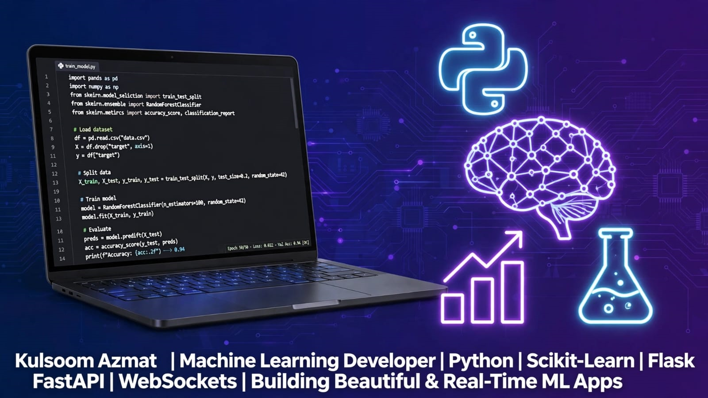

  

I'm Kulsoom | A Female ML Developer from Karachi Pakistan 🇵🇰

I build beautiful, lightweight & real-time ML web apps

My Stack:
Python | NumPy | Pandas | Scikit-Learn | Flask | FastAPI | WebSockets

What I Do:

Supervised Algorithms: Spam Classification (NB, LR, SVM), Fake News Detection, House Price Prediction, Smart Reply
Unsupervised Algorithms: Anomaly Detection with Isolation Forest.
Real-Time APIs: Production-ready APIs with FastAPI + WebSockets.
Amazon E-Commerce Data Cleaning: Cleaned messy Amazon orders data and converted it into analysis-ready format.
Shopify Store Sales Analysis, Shopify business report + Looker Studio Dashboard.                                                   

📂 11+ End-to-End Repositories
💻 Female in Tech | Open to Freelance & Collaborations

📧 Let's build your AI product together!
